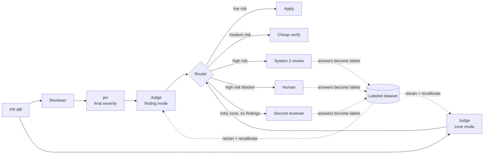

# Uncertainty Judge: Training Design

13 Oct 2026 · @Jayson Steffens

## Purpose and scope

The uncertainty judge predicts the probability that a review decision is wrong, so the pipeline knows when to trust it
and when to escalate. It is a System 1 component: one pass, fixed cost, no reasoning.

What it does:

- Scores each final severity decision (`nit`, `should`, `medium`, `blocker`) after jev with a calibrated error
  probability.
- Scores each changed code zone with a probability that it holds a bug the review did not report.
- Routes the result: apply, verify cheaply, or escalate to a System 2 step or a human.

What it does not do:

- It does not assign severity. That stays with jev.
- It does not find bugs. It points deeper review at the zones most likely to hide one.
- It is not the same model as the reviewer or jev. An independent judge sees blind spots a self-check misses.

## Placement in the pipeline

The judge runs in two modes. **Finding mode** audits each severity after jev. **Zone mode** scores the diff itself, so
bugs the review never reported still get a second look.

Zone mode reads the PR diff directly, not the review output. That independence is what lets it catch false negatives.

## Signals and features

Use cheap signals that already exist in the pipeline. Start with the first two; add the rest only if they improve
held-out results.

| Signal | Mode | What it measures | Source |
| --- | --- | --- | --- |
| jev margin | Finding | Gap between jev's top severity and the next one. Small gap means doubt. | jev output scores |
| Novelty distance | Both | Distance from the case to its nearest past cases in embedding space. Catches cases jev is confidently wrong about. | Vector index over past findings and diffs |
| Reviewer and jev disagreement | Finding | Size of the severity change jev applied, in steps. | Pipeline log |
| Missing context | Finding | Finding refers to code, config or entities not present in the diff context. | Pipeline log |
| File bug history | Zone | Past bugs, incidents and reopened PRs tied to the file. | Git blame + Jira links |
| Churn and complexity | Zone | Recent change frequency and cyclomatic complexity of the changed code. | Git + static analysis |
| Test coverage of the change | Zone | Share of changed lines covered by tests. | Coverage report |
| Diff size | Zone | Lines changed in the PR. Large diffs lower review attention. | Git |
| Historical correction rate | Both | How often this finding type or file area was corrected before. | Labeled dataset |

If jev does not expose scores, ask it for a confidence value per decision as a first step.

## Labels and dataset construction

Labels come from real outcomes, not from another model's opinion. A model-labeled dataset teaches the judge to copy that
model's blind spots.

**Finding mode**, one row per final severity decision:

- Label = 1 (wrong) when a human changed the severity, the finding was dismissed as a false positive, or a lower-rated
  finding later caused an incident or a reopened PR.
- Label = 0 (right) when the decision stood through merge and a fixed observation window with no correction.
- Store the severity gap in steps as a second target. Off by one and off by three are different errors.

**Zone mode**, one row per changed file or hunk:

- Label = 1 when a bug found later (production incident, reopened PR, later fix commit) traces back to that zone and the
  review reported nothing there.
- Label = 0 when no later bug traces back within the observation window.
- Add seeded bugs from mutation testing. A mutant the review missed is a labeled false negative you control.

**Dataset rules:**

- Split by time, not at random. Train on older PRs, test on newer ones. A random split leaks future patterns.
- Keep rows with no correction yet out of the training set until the observation window closes.
- Log every input signal at decision time. Rebuilding features afterwards leaks information the judge never had.

> **Open question:** the observation window length. It must cover the typical time from merge to incident in this
> codebase.

## Model and calibration

Build in three stages. Move to the next stage only when the current one stops improving held-out results.

1. **Rule baseline.** Two signals, jev margin and novelty distance, with fixed thresholds. No training. This sets the bar
   every later model must beat.
2. **Gradient boosting classifier.** All signals as tabular features, one model per mode. Small, fast, and its feature
   importances are easy to inspect.
3. **Small neural judge.** Only if text of the diff or finding adds signal the tabular features miss. Feed it
   embeddings, not raw text, to keep it cheap.

Calibration is mandatory. A raw score is a ranking, not a probability.

- Fit isotonic regression or Platt scaling on a held-out calibration split, separate from the test split.
- After calibration, a predicted risk of 0.3 should match roughly a 30% observed error rate in that bucket.
- Recalibrate after every retraining and whenever jev or the reviewer changes.

## Routing policy and thresholds

Thresholds depend on the cost of the error, not on one global number. Missing a blocker costs more than a needless human
check.

| Final severity | Apply directly | Cheap verify | Escalate |
| --- | --- | --- | --- |
| Blocker | Risk below a low threshold | Never | Above it, to a human |
| Medium | Low risk | Medium risk | High risk, to System 2 review |
| Should | Low risk | Medium risk | High risk, to System 2 review |
| Nit | Most cases | Rarely | Only with high novelty |

Zone mode: a zone with high risk and zero findings goes to a second, different reviewer (another model or a focused
prompt such as security or concurrency).

How to set the thresholds:

- Fix a target escalation rate first, for example 10% of decisions. Tune thresholds to hit it.
- Measure the error rate on what was not escalated. That is the number the team experiences.
- Track over-rating too. Too many inflated severities cause alert fatigue, even if no blocker escapes.

## Evaluation and acceptance criteria

The judge ships only if it beats the rule baseline on the time-split test set. Targets below are starting points to
confirm with the first data.

| Metric | What it tells you | Acceptance |
| --- | --- | --- |
| AUROC | Does the judge rank wrong decisions above right ones | Better than rule baseline |
| Expected calibration error (ECE) | Do predicted risks match observed error rates | Below 0.05 |
| Risk-coverage curve | Error rate on accepted decisions at each escalation rate | Lower error than baseline at the target escalation rate |
| Blocker miss rate | Share of true blockers accepted below blocker | Lower than without the judge |
| Over-rating rate | Share of findings rated higher than outcome supports | Tracked, not gated at first |
| Mutation recall (zone mode) | Share of seeded bugs in zones flagged as high risk | Higher than random zone selection |

Report every metric per severity level. A good average can hide a poor blocker score.

## Feedback loop and retraining

Every escalated case returns with a System 2 or human answer. That answer is a new label for the judge and for jev.

- Log escalations with the final decision and who made it.
- Link every production incident and reopened PR back to its originating PR and zone. Each escaped bug becomes a
  zone-mode training row.
- Retrain on a fixed cadence, for example monthly, plus on demand when calibration error drifts above the threshold.
- Watch for selection bias: decisions the judge accepts get fewer human checks, so their errors surface later. Send a
  small random sample of accepted decisions to human review to keep labels honest.
- Feed escalated cases to jev's training set too. Over time jev absorbs what used to need deliberation, and the
  escalation rate should fall.

## Rollout plan

Nothing routes live until the trained judge beats the rule baseline on the same shadow traffic.

Ship finding mode first. Its labels arrive faster, and zone mode needs a longer observation window.

## Risks and open questions

| Risk | Effect | Mitigation |
| --- | --- | --- |
| Too few labeled errors | Judge cannot learn the rare blocker case | Start with the rule baseline; add mutation-seeded bugs |
| Selection bias in labels | Accepted errors stay unlabeled longer | Random human audit of accepted decisions |
| Drift after jev or reviewer changes | Calibration breaks silently | Recalibrate on every upstream change; alert on ECE |
| Correlated blind spots | Judge misses what jev misses | Keep the judge independent of jev and the reviewer |
| Alert fatigue | Team stops reading escalations | Cap escalation rate; track over-rating |

Open questions:

- [ ] Does jev expose per-decision scores, or does it need a confidence output first?
- [ ] How many corrected decisions exist in the current logs?
- [ ] What observation window covers merge-to-incident time in this codebase?
- [ ] Which happens more today: wrong severities or false-positive findings? That decides which mode ships first.
